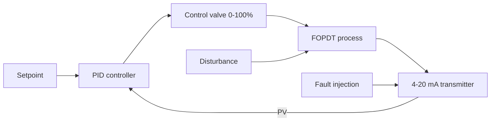

# Architecture

## 1. Signal path

## 2. Models

| Module | Responsibility |
| --- | --- |
| `process_models.FOPDT` | Gain, time constant and dead time; disturbance input |
| `transmitters.Transmitter` | 4-20 mA scaling, burnout/frozen faults |
| `pid_controller.PIDController` | PI/PID math, anti-windup, manual/auto |
| `tuning` | Ziegler-Nichols, Cohen-Coon and IMC suggestions |
| `instruments_server` | Simulation loop, REST API and HMI serving |

## 3. Timing

- Simulation step: 0.2 s.
- Trend window: last 200 samples (40 s).
- Dead time implemented as a FIFO of delayed valve commands.

## 4. Nota (ES)

El objetivo no es reemplazar un simulador de procesos de alta fidelidad, sino hacer visible y reproducible el comportamiento de un lazo industrial típico.
